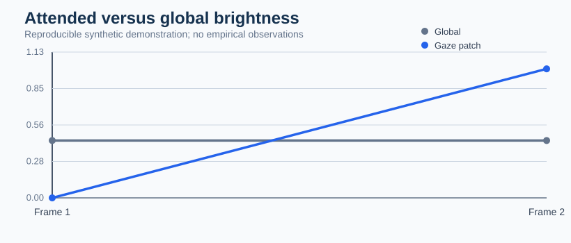
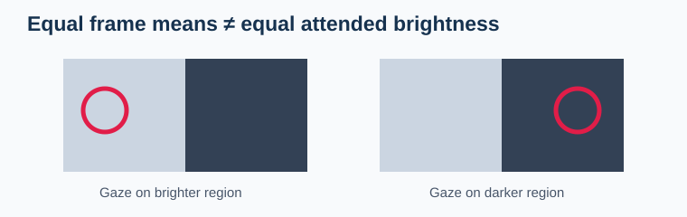

# Visual complexity and gaze-contingent luminance in pupil analysis

**Experimental visual-feature extraction and sensitivity diagnostics (October 2026).** The functions here are not Bayesian posterior estimators and do not supply a validated causal correction for pupil response.

A screen's average brightness can stay constant while the participant fixates a darker or brighter region. The experimental `extract_gaze_contingent_features()` pairs normalized gaze locations with synchronized grayscale stimulus frames and computes patch-average brightness plus orientation-distribution entropy.

### Executable synthetic example

~~~python
import numpy as np
from research.october_2026.stimulus_covariates import extract_gaze_contingent_features

stimulus = np.zeros((9, 9))
stimulus[:, 5:] = 1
frames = np.stack([stimulus, stimulus])
gaze_xy = [[.1, .5], [.9, .5]]
features = extract_gaze_contingent_features(frames, gaze_xy, radius_px=1)
print(features)
~~~

### Original plot recipe

~~~python
import matplotlib.pyplot as plt
fig, ax = plt.subplots(figsize=(5, 3))
ax.plot(features.frame_index, features.global_brightness, "o-", label="Whole image")
ax.plot(features.frame_index, features.attended_patch_brightness, "s-", label="Gaze region")
ax.set(xlabel="Synthetic frame", ylabel="Normalized image brightness")
ax.legend()
fig.tight_layout()
~~~

The optional `pupil_adjustment_design_audit()` compares a declared within-participant condition contrast before and after including image-feature covariates in a **descriptive OLS sensitivity design**. It refuses collinear designs and makes no Bayesian inference.

### Scientific boundaries

- Gray pixel intensity is not calibrated retinal luminance.
- Orientation entropy estimated from generic pictures is not yet a universal physiological complexity correction.
- A covariate can be part of the experimental treatment mechanism; adjustment may change the estimand.
- Video/gaze synchronization, frame provenance, contrast, viewing geometry and participant bootstrap validation remain necessary before any substantive pupillometry claim.

## Publication and qualification status (21 October 2026)

This page and its original synthetic figures are merged into the GitHub documentation source. The worked research modules are under `research/october_2026/` and **are not automatically included in installed PyPI wheels or exported as stable package APIs**. Their empirical accuracy, device transfer and inferential calibration are not implied by a green CI test or a successful website build.

The explicit outstanding scientific acceptance criteria and eligible real-data benchmarks are tracked in [research-to-release issue #23](https://github.com/stefanosbalaskas/gp3bayespy/issues/23). This source-only research contribution is separate from the existing stable package version, and a new maintenance release must not claim these experiments as installed features.
